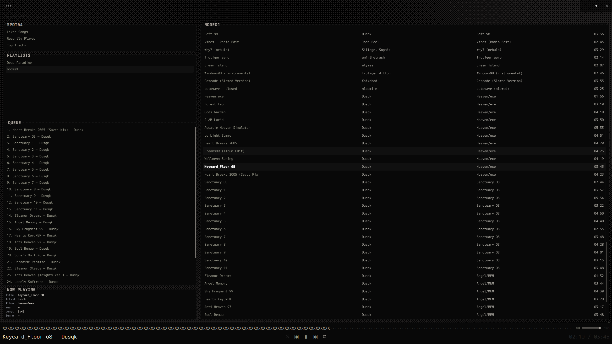
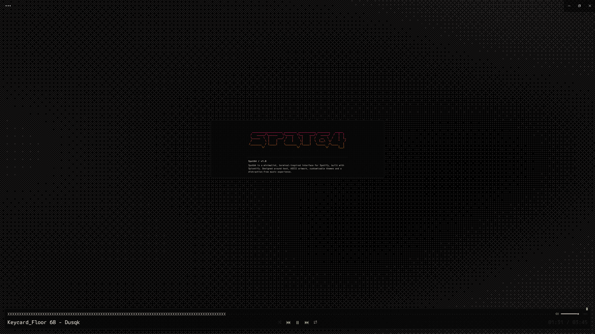

Spot64 / V1.0
Spicetify Theme.

**Terminal character. Modern playback. Your interface.**

Spot64 is a customizable desktop Spotify interface built with [Spicetify](https://spicetify.app/). It combines terminal-inspired styling, six built-in themes, animated Dither wallpaper, interactive mouse effects, ASCII artwork, and integrated playback controls.


+----------------------------[ SHOWCASE ]----------------------------+


| Main interface | Dither wallpaper + ASCII artwork |
| :---: | :---: |
|  |  |

> **Screenshots:** Add two images to the `assets` folder using the exact filenames `Spot64-Interface.png` and `Spot64-Dither.png`. The previews will appear here automatically once those files are uploaded to GitHub.


+-----------------------------[ CREDITS ]----------------------------+


Created by **[dotded](https://github.com/dotded)**.

Spot64 is built for the [Spicetify](https://spicetify.app/) customization ecosystem. Spotify and the other services referenced by the visual presets are trademarks of their respective owners. Spot64 is an independent project and is not affiliated with or endorsed by them.


+----------------------------[ INSTALL ]----------------------------+


### Requirements

- Windows with the Spotify desktop application installed.
- [Spicetify CLI](https://spicetify.app/docs/getting-started/) installed and initialized, with `spicetify` available in PowerShell.
- PowerShell 5.1 or newer.

### Option 1 — Install from the repository

1. Open this repository on GitHub and select **Code → Download ZIP**.
2. Extract it, then open PowerShell **inside the extracted folder containing `Install-Spot64.ps1`**.
3. Run:

```powershell
powershell -NoProfile -ExecutionPolicy Bypass -File .\Install-Spot64.ps1
```

4. When the installer succeeds, launch or return to Spotify. The script runs `spicetify apply` for you.

**What the installer does:** checks source-file SHA-256 hashes against `manifest.json`, detects existing Spot64 extensions, creates a backup, installs and registers the eight active extensions, then applies Spicetify. If verification fails, it stops instead of silently overwriting unrecognized files.

### Option 2 — One-line install (after the V1.0 release is published)

Once the `V1.0` tag has been created and tested in this public repository, the version-pinned installation command is:

```powershell
irm https://raw.githubusercontent.com/dotded/Spot64-Spicetify-Theme/V1.0/bootstrap.ps1 | iex
```

**Requires the `V1.0` tag.** Review [`bootstrap.ps1`](bootstrap.ps1) and [`Install-Spot64.ps1`](Install-Spot64.ps1) before executing a remotely downloaded script. For a more reviewable process, use Option 1.

### Restore a previous installation

From the folder containing `Restore-Spot64.ps1`, run:

```powershell
powershell -NoProfile -ExecutionPolicy Bypass -File .\Restore-Spot64.ps1
```

The restore script uses the latest successful Spot64 backup and runs `spicetify apply`. Backups are stored in `%APPDATA%\spicetify\spot64-backups`. It refuses to overwrite files that have changed since installation; follow the error message and restore manually if that occurs.

> **Personal themes:** File backups do not include Spotify browser `localStorage`. Export any important saved themes or settings separately before reinstalling or changing Spotify data.


+----------------------------[ FEATURES ]---------------------------+


### Six built-in themes

| Theme | Visual style |
| --- | --- |
| **Spot64** | A simple terminal-inspired UI |
| **Catppuccin** | A standard Catppuccin palette |
| **Spotify** | Sleek dark surfaces with green accents |
| **Access Granted** | Phosphor-green terminal styling |
| **Discord** | Charcoal surfaces and blurple accents |
| **Twitch** | Dark surfaces and purple accents |

Create and save your own themes without replacing the built-in collection. Custom CSS import, export, and advanced overrides provide more detailed styling control.

### Animated Dither wallpaper

- GPU-rendered Dither wallpaper with adjustable pattern, pixel size, colours, opacity, and animation speed.
- Automatic colour matching with the selected theme, with a manual-colour option.
- **33 selectable mouse effects**, organized by category, with strength, radius, and smoothing controls.
- Optional mouse parallax and separately selectable click effects.

### Focus Mode and ASCII artwork

- Use the on-screen **`-`** control to hide the main panels and focus on the wallpaper; **`+`** restores them.
- Toggle **`~`** to display or dismiss animated ASCII artwork in its own framed window over the wallpaper.
- Theme-aware borders, rounded corners, and configurable panel styling.

### Playback and customization

- Playback controls, seeking, volume slider, and mute control.
- Library browsing, queue, history, and additional playback features.
- Customize panel for everyday appearance settings and advanced styling options.
- Adjustable borders, typography, panel colours, seek-bar presentation, and CSS overrides.


+----------------------------[ PROJECT ]----------------------------+


| Path | Description |
| --- | --- |
| `Extensions/` | Eight active Spot64 JavaScript extensions |
| `Install-Spot64.ps1` | Installer with integrity checks and backups |
| `Restore-Spot64.ps1` | Restores a completed installation backup |
| `bootstrap.ps1` | Version-pinned installation entry point |
| `manifest.json` | V1.0 extension manifest and checksums |
| `tests/` | Source validation checks |
| `docs/` | Audit notes and release checklist |
| `assets/` | The two repository showcase screenshots |

For source validation, run `node tests/check-sources.js` and `node tests/check-signatures.js` with Node.js installed.
